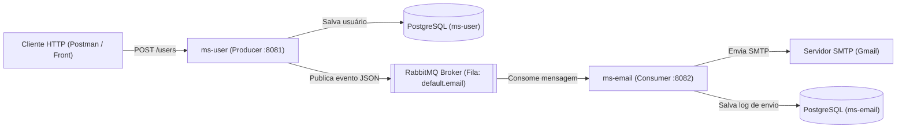

# 🚀 Spring Boot Microservices with RabbitMQ (`ms-user` & `ms-email`)

Ecossistema de **Microsserviços orientados a eventos** desenvolvido com **Java 21**, **Spring Boot 4.1.2**, **RabbitMQ (AMQP)**, **PostgreSQL**, **Lombok**, **MapStruct** e **JavaMailSender**.

---

## 🎯 Sobre o Projeto

Este repositório demonstra na prática o padrão de comunicação assíncrona **Producer / Consumer** utilizando um **Message Broker (RabbitMQ)** para desacoplar microsserviços independentes com bancos de dados isolados (**Database per Service**):

1. **[`user` (`ms-user` - Producer)](./user/README.md):** Gerencia o cadastro e consulta de usuários, persiste os dados no banco `ms-user` e publica eventos de boas-vindas na fila `default.email` do RabbitMQ.
2. **[`email` (`ms-email` - Consumer)](./email/README.md):** Escuta continuamente a fila `default.email` via `@RabbitListener`, realiza o envio do e-mail via **SMTP (Gmail)** e persiste o histórico/status (`SENT` ou `ERROR`) no banco `ms-email`.



---

## 🛠 Stack e Tecnologias

* **Java 21** & **Spring Boot 4.1.2**
* **Spring AMQP / RabbitMQ (CloudAMQP)** — Mensageria assíncrona e filas duráveis
* **Spring Data JPA / Hibernate + PostgreSQL** — Persistência relacional isolada por serviço
* **Spring Mail (`JavaMailSender`)** — Envio de e-mails via SMTP (STARTTLS)
* **MapStruct + Lombok** — Mapeamento performático entre DTOs (Records) e Entidades JPA
* **Bean Validation & `@RestControllerAdvice`** — Validação de entrada e tratamento global de exceções

---

## 📂 Estrutura do Repositório

| Serviço | Papel | Porta Padrão | Documentação Detalhada |
| :--- | :--- | :---: | :--- |
| **`user/`** | API de Usuários + **RabbitMQ Producer** | `8081` | [📄 Ver README do `ms-user`](./user/README.md) |
| **`email/`** | **RabbitMQ Consumer** + Envio SMTP + Histórico | `8082` | [📄 Ver README do `ms-email`](./email/README.md) |

---

## ⚡ Como Executar Rápido

1. Crie os bancos de dados `ms-user` e `ms-email` no seu PostgreSQL.
2. Em cada pasta (`user/` e `email/`), copie o arquivo `.env.example` para `.env` e preencha suas credenciais do PostgreSQL, CloudAMQP e Senha de App do Gmail:
   ```bash
   cp user/.env.example user/.env
   cp email/.env.example email/.env
   ```
3. Suba os dois microsserviços pela sua IDE ou via terminal:
   ```bash
   # Terminal 1 - Microsserviço de E-mail (Consumer)
   cd email && ./mvnw spring-boot:run

   # Terminal 2 - Microsserviço de Usuário (Producer)
   cd user && ./mvnw spring-boot:run
   ```

---

**Autor:** Luan Alves de Souza
