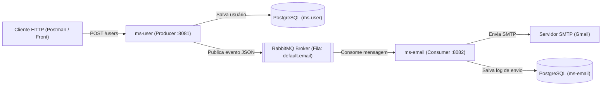

# 🚀 User Microservice (`ms-user`)

Microsserviço responsável pelo gerenciamento e cadastro de usuários, atuando como **Producer (Produtor)** na arquitetura orientada a eventos com **RabbitMQ**.

---

## 🎯 Contexto e Objetivo do Projeto

Este projeto foi desenvolvido com o objetivo prático de estudar e consolidar conceitos fundamentais da **Arquitetura de Microsserviços** e **Mensageria Assíncrona** com **RabbitMQ (Message Broker)**.

Em uma arquitetura distribuída, operações secundárias como o envio de um e-mail de boas-vindas não devem bloquear ou atrasar a resposta do cadastro do usuário (nem causar falha no cadastro caso o servidor de SMTP esteja temporariamente indisponível).

Para resolver isso, o ecossistema foi dividido em dois microsserviços independentes, cada um com seu próprio banco de dados (**Database per Service**):

1. **`ms-user` (Este serviço - Producer):** Recebe a requisição HTTP de cadastro, valida as regras de negócio, persiste o usuário no banco `ms-user` e publica uma mensagem assíncrona na fila `default.email` do RabbitMQ.
2. **`ms-email` (Consumer):** Escuta a fila `default.email`, consome a mensagem, realiza o disparo real do e-mail via SMTP (Gmail) e registra o histórico/status de envio (`SENT` ou `ERROR`) no banco `ms-email`.



---

## 🛠 Principais Tecnologias

* **Linguagem:** Java 21
* **Framework:** Spring Boot 4.1.2 (Spring Web MVC, Spring Data JPA, Spring Validation)
* **Mensageria:** Spring AMQP + RabbitMQ (CloudAMQP)
* **Banco de Dados:** PostgreSQL (`ms-user`)
* **Produtividade e Mapeamento:** Lombok + MapStruct
* **Tratamento de Erros:** `@RestControllerAdvice` padronizado (`ApiExceptionHandler`)

---

## 📂 Estrutura de Pacotes

```text
com.ms.user
├── config/             # Configuração do RabbitMQ e conversor JSON (Jackson)
├── controller/         # Endpoints REST (/users)
├── dto/                # Records de entrada, saída e payload da fila
├── entity/             # Entidade JPA (TB_USERS)
├── exception/          # Exceções de negócio e Handler global (@RestControllerAdvice)
├── mapper/             # Mapeamento DTO <-> Entity via MapStruct
├── producer/           # Publicação de mensagens no RabbitMQ (RabbitTemplate)
├── repository/         # Persistência de dados com Spring Data JPA
└── service/            # Regras de negócio e orquestração transacional
```

---

## ⚙️ Configuração e Variáveis de Ambiente

As credenciais e configurações sensíveis foram externalizadas via variáveis de ambiente. O projeto suporta leitura automática de arquivo `.env` local.

1. Copie o arquivo de exemplo na raiz do serviço:
   ```bash
   cp .env.example .env
   ```
2. Preencha as variáveis no arquivo `.env`:

| Variável | Descrição | Valor Padrão |
| :--- | :--- | :--- |
| `SERVER_PORT` | Porta HTTP do microsserviço | `8081` |
| `DB_URL` | URL JDBC do banco PostgreSQL | `jdbc:postgresql://localhost:5432/ms-user` |
| `DB_USERNAME` | Usuário do banco de dados | `postgres` |
| `DB_PASSWORD` | Senha do banco de dados | *(Obrigatório)* |
| `RABBITMQ_ADDRESSES` | URL AMQPS do broker RabbitMQ / CloudAMQP | *(Obrigatório)* |
| `BROKER_QUEUE_EMAIL_NAME` | Nome da fila de e-mails no broker | `default.email` |

---

## ⚡ Como Executar

1. Certifique-se de que o banco de dados **`ms-user`** exista no seu PostgreSQL local.
2. Configure o arquivo `.env` conforme a tabela acima.
3. Execute a aplicação via Maven ou diretamente pela sua IDE:
   ```bash
   ./mvnw spring-boot:run
   ```

---

## 📌 Endpoints Disponíveis

### 1. Cadastrar Usuário
* **POST** `/users` *(ou `/users/save`)*
* **Request Body:**
  ```json
  {
    "name": "Luan Alves",
    "email": "alvesluanpc@gmail.com"
  }
  ```
* **Responses:**
  * `201 Created`: Usuário salvo no banco e evento publicado na fila do RabbitMQ.
  * `400 Bad Request`: Campos obrigatórios ausentes ou formato de e-mail inválido.
  * `409 Conflict`: E-mail já cadastrado.

### 2. Listar Todos os Usuários
* **GET** `/users`
* **Response:** `200 OK` com a lista de `UserResponseDTO`.

### 3. Buscar Usuário por ID
* **GET** `/users/{userId}`
* **Response:** `200 OK` ou `404 Not Found`.

---

**Autor:** Luan Alves de Souza

